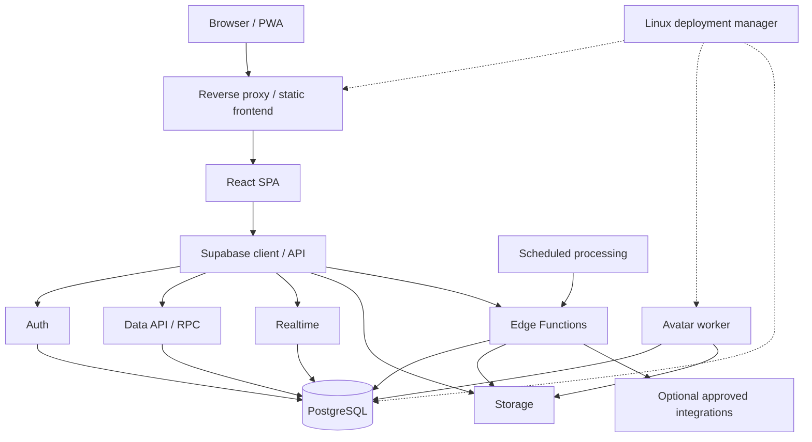

# Spark — ممیزی فنی و معماری نرم‌افزار (مرحله ۱)

> تاریخ: 2026-11-26 / ۱۴۰۵-۰۹-۰۵ · وضعیت: **Baseline / PARTIAL — در حال تکمیل، نه تأییدیه امنیتی**
>
> مبنای ارزیابی: نسخه سورس‌کد دریافت‌شده در تاریخ ۱۴۰۵-۰۹-۰۵؛ شناسه نسخه فنی: `c1bc5a80e1ef5d033da1f3f227ef34a8d0acdf42`.
>
> این سند صرفاً وضعیت فنی نرم‌افزار و شواهد ممیزی را ثبت می‌کند. داده‌های واقعی، مقادیر محرمانه و جزئیات حساس امنیتی در آن درج نمی‌شوند.

## ۱. هدف و دامنه

ثبت معماری منطقی، قابلیت‌ها، وابستگی‌های نرم‌افزار و شواهد بررسی اولیه به عنوان خط مبنا برای آمادگی استقرار سازمانی. فهرست کامل فایل‌های نسخه نرم‌افزار، manifestها و lockfileهای npm و نمونه‌های منتخب کد و تنظیمات خوانده شدند. نسخه سورس‌کد در محیط محلی استخراج شد و هر ۸۶۷ فایل JavaScript/TypeScript با تحلیل متنی importها و الگوهای مشخص بررسی شد. npm audit و بررسی pin وابستگی Edge نیز انجام شد. این بررسی به معنی بازبینی معنایی خط‌به‌خط همه فایل‌ها، تست رگرسیون، اندازه‌گیری RAM، اسکن جامع همه CVEها، ممیزی دیتابیس فعال یا تست نفوذ نیست. هیچ تغییری در کد اجرایی یا دیتابیس داده نشده است.

### وضعیت اقدامات

| فعالیت | وضعیت | شاهد |
|---|---|---|
| شناسایی نسخه و ساختار نرم‌افزار | انجام شد | فهرست کامل ۱٬۲۶۰ فایل |
| شمارش ماژول‌ها و تست‌ها | انجام شد | فهرست فایل‌ها |
| وابستگی‌های مستقیم و نسخه‌های قفل‌شده | انجام شد | package.json و دو package-lock.json |
| بررسی ورودی SPA و مسیرهای UI | نمونه‌برداری انجام شد | main، App، AuthenticatedApp، PageRenderer |
| بررسی client API و PWA | نمونه‌برداری انجام شد | supabase.ts، invokeEdgeFunction، sw.js، manifest |
| بررسی Worker و تعریف container | نمونه‌برداری انجام شد | worker/index.js، Dockerfile، package.json |
| بررسی معماری نصب و مدیریت سرور | مستند و manifest منتخب خوانده شد | Server Manager README و spark-build.yaml |
| نقشه import داخلی و چرخه‌ها | تحلیل متنی انجام شد؛ اعتبارسنجی باز | ۸۶۷ فایل، نیازمند AST/build |
| اسکن CVE npm | انجام شد، موارد باز | ۲ Moderate در root، صفر در Worker؛ محدوده npm |
| SBOM استاندارد، CVE غیر npm و License review | باز | نیازمند تکمیل بررسی |
| اسکن اولیه مقادیر محرمانه در سورس‌کد | انجام شد (محدود) | ۹۴۰ فایل؛ صفر تطابق در ۵ الگوی مشخص |
| اسکن جامع مقادیر محرمانه و خروجی build | باز | اسکن تخصصی و artifact لازم است |
| اجرای نمونه آزمون‌های امنیتی | انجام شد، ناموفق | ۳ فایل تست؛ دو ENOENT و یک SyntaxError |
| تست کامل رگرسیون و build | باز | اجرا نشده |
| اندازه‌گیری RAM/CPU، heap و منابع | باز | اجرا نشده |
| ممیزی Supabase runtime، RLS و RPC | مرحله ۲ | خارج از دامنه فعلی |
| DAST/Pentest و Retest | باز | محیط ایزوله و داده مصنوعی |
| آمادگی نهایی بهره‌برداری | تأیید نشده | وابسته به بستن گیت‌های پذیرش |

## ۲. ساختار و مقیاس

| مسیر | تعداد فایل |
|---|---:|
| src | 642 |
| deploy | 269 |
| tests | 195 |
| supabase | 87 |
| docs | 24 |
| public | 14 |
| worker | 8 |
| scripts | 8 |
| فایل‌های ریشه | 13 |
| کل | 1260 |

مجموع اندازه blobها در این snapshot: 10,052,594 بایت (اندازه فایل‌ها، نه RAM یا اندازه build).
تعداد فایل‌های src: 642، deploy: 269، tests: 195، docs: 24، supabase: 87، public: 14، worker: 8، scripts: 8.
تعداد Edge Functionهای دارای index.ts: 56؛ پوشه‌های اشتراکی جزء تابع مستقل محسوب نمی‌شوند.
سه فایل migration در مسیر supabase/migrations ثبت شده‌اند؛ این شمارش معادل تاریخچه کامل DB نیست و دارایی‌های SQL و baseline موجود در deploy باید جداگانه تطبیق داده شوند.

## ۳. معماری منطقی

این نمودار معماری منطقی استخراج‌شده از سورس‌کد است؛ نقشه شبکه واقعی، توپولوژی HA، تنظیمات Gateway و وضعیت واقعی سرویس‌های مقصد را نشان نمی‌دهد.

- Presentation: React 19، TypeScript، Vite، Tailwind، رابط فارسی RTL، نصب PWA و فایل‌های محلی فونت.
- Application: تقسیم بارگذاری با lazy/Suspense و مسیر جداگانه ورود عمومی و برنامه احراز هویت‌شده. مسیریابی و کنترل نمایش صفحات در app/navigation، داده‌ها و وضعیت دسترسی در hookها و feature moduleها.
- Data access: Supabase JS SDK، REST/RPC، Auth، Storage، Realtime و Edge Functions. production build درخواست‌ها را به origin سامانه هدایت می‌کند؛ وجود reverse proxy و پیکربندی درست آن پیش‌نیاز است.
- Processing: توابع Edge برای جریان‌های احراز هویت، مدیریت کاربر، اطلاع‌رسانی، پردازش زمان‌بندی‌شده، عملیات مستندات و یکپارچه‌سازی‌ها. Worker مستقل Node/Sharp برای پردازش آواتار، صف، heartbeat و health check.
- Deployment: Server Manager مبتنی بر Bash و Python curses؛ مستند موجود نسخه 3.0.0 را معرفی می‌کند. build manifest به npm ci، npm run build و dist اشاره دارد. وضعیت واقعی runtime و نسخه نصب‌شده باید مستقل اعتبارسنجی شود.

## ۴. قابلیت‌های قابل شناسایی

| حوزه | شواهد ساختاری | وابستگی منطقی |
|---|---|---|
| ورود، نشست، بازیابی و MFA | src/features/auth، security-settings | Auth، توابع سمت سرور |
| مدیریت کاربران، ساختار سازمانی، گروه‌ها | src/components/UserManagement، OrgStructure، UserGroups | API، مجوزها |
| جلسات و جلسات تکرارشونده | src/features/meetings | API، تقویم، اعلان |
| تقویم و برنامه‌ریزی | src/components/Calendar، CalendarMeetingForm | جلسات، API، کنترل دسترسی |
| دستور جلسات، صورت‌جلسات و مصوبات | src/components/Agenda، Minutes | API، Storage، گردش تأیید، DOCX |
| کارها و یادداشت‌ها | src/components/Tasks، Notes | API، یادآوری |
| پیام‌رسانی و گروه‌های کاری | src/components/Chat، Channels | API، Realtime، Storage |
| گزارش و داشبورد | ReportsPage، ManagementDashboardPage | RPC و داده‌های مجاز |
| مخاطبان و پروفایل | ContactsPage، ProfilePage | API، Storage، Worker |
| اعلان و Push | src/features/notifications، PWA workers | API، queue، provider |
| تنظیمات و مانیتورینگ | PortalConfig، SystemMonitoring | مجوز مدیریت، API |
| پشتیبان‌گیری | BackupPanel، Server Manager | عملیات مجاز سرور |
| یکپارچه‌سازی و دستیار | Spark، config، Edge functions | سرویس‌های اختیاری، سیاست خروجی شبکه |

وجود فایل یا route به معنی فعال بودن، سلامت یا مجاز بودن قابلیت در محیط production نیست.

### نقشه ماژول‌های feature

| مسیر | تعداد فایل |
|---|---:|
| `src/features/auth` | 26 |
| `src/features/meetings` | 64 |
| `src/features/messaging` | 3 |
| `src/features/not-found` | 3 |
| `src/features/notifications` | 30 |
| `src/features/onboarding` | 3 |
| `src/features/permissions` | 6 |
| `src/features/security-settings` | 13 |
| `src/features/user-preferences` | 6 |

### نقشه کامپوننت‌ها (مسیرهای گروه‌بندی شده)

| مسیر | تعداد فایل |
|---|---:|
| `src/components/Agenda` | 4 |
| `src/components/Backup` | 3 |
| `src/components/Calendar` | 35 |
| `src/components/CalendarMeetingForm` | 20 |
| `src/components/Channels` | 15 |
| `src/components/Chat` | 30 |
| `src/components/Contacts` | 1 |
| `src/components/Minutes` | 67 |
| `src/components/Notes` | 18 |
| `src/components/NotificationsConfig` | 10 |
| `src/components/OrgStructure` | 11 |
| `src/components/PortalConfig` | 9 |
| `src/components/Profile` | 6 |
| `src/components/RahyabConfig` | 6 |
| `src/components/SmsConfig` | 9 |
| `src/components/SocialNotifications` | 5 |
| `src/components/Spark` | 6 |
| `src/components/SparkConfig` | 8 |
| `src/components/SystemMonitoring` | 14 |
| `src/components/Tasks` | 23 |
| `src/components/Tutorial` | 19 |
| `src/components/ui` | 3 |
| `src/components/UserGroups` | 11 |
| `src/components/UserManagement` | 22 |

### مسیر اجرایی سطح بالا

`src/main.tsx → App.tsx → PublicAuthRoot / AuthenticatedRoot → AuthenticatedApp → AppShell / PageRenderer → feature/component → supabase client / Edge function helper`.
این مسیر از importهای فایل‌های منتخب استخراج شده است، نه گراف کامل همه importها. Client-side permissions برای UX است؛ مجوز نهایی باید مستقل در سمت سرور و دیتابیس اعمال شود.

## ۵. وابستگی‌های نرم‌افزاری

هر دو lockfile از نوع 3 هستند. برنامه اصلی ۱۳ dependency مستقیم runtime و ۱۳ dev dependency دارد؛ lockfile شامل ۲۹۸ entry غیرریشه (۱۳۸ بدون dev flag، ۱۶۰ با dev flag) است. Worker دارای ۲ dependency مستقیم و ۴۰ entry غیرریشه است. این اعداد شمار entryهای lockfile هستند، نه تعداد packageهای یکتا یا packageهای واقعاً نصب‌شده؛ optional/platform entries نیز ممکن است وجود داشته باشند. در entryهای دارای resolved، مورد فاقد integrity در این دو lockfile شمارش نشد؛ این مشاهده جایگزین اعتبارسنجی منشأ، امضای artifact یا CVE scan نیست.

| بخش | پکیج | محدوده manifest/lock root | نسخه قفل‌شده | نوع |
|---|---|---|---|---|
| Frontend | `@react-oauth/google` | `^0.13.5` | `0.13.5` | runtime |
| Frontend | `@supabase/supabase-js` | `2.119.0` | `2.119.0` | runtime |
| Frontend | `docx` | `^9.15.3` | `9.15.3` | runtime |
| Frontend | `exceljs` | `^4.4.0` | `4.4.0` | runtime |
| Frontend | `html-to-image` | `^1.11.13` | `1.11.13` | runtime |
| Frontend | `lucide-react` | `^1.72.0` | `1.72.0` | runtime |
| Frontend | `moment` | `^2.31.0` | `2.31.0` | runtime |
| Frontend | `moment-jalaali` | `^0.10.5` | `0.10.5` | runtime |
| Frontend | `react` | `^19.3.1` | `19.3.1` | runtime |
| Frontend | `react-datepicker` | `^9.1.0` | `9.1.0` | runtime |
| Frontend | `react-dom` | `^19.3.1` | `19.3.1` | runtime |
| Frontend | `react-hot-toast` | `^2.6.1` | `2.6.1` | runtime |
| Frontend | `uuid` | `^14.0.3` | `14.0.3` | runtime |
| Frontend | `@tailwindcss/postcss` | `^4.3.5` | `4.3.5` | development |
| Frontend | `@types/moment-jalaali` | `^0.7.9` | `0.7.9` | development |
| Frontend | `@types/react` | `^19.3.0` | `19.3.0` | development |
| Frontend | `@types/react-dom` | `^19.3.0` | `19.3.0` | development |
| Frontend | `@vitejs/plugin-react` | `6.3.0` | `6.3.0` | development |
| Frontend | `autoprefixer` | `^10.6.2` | `10.6.2` | development |
| Frontend | `dotenv` | `^18.0.10` | `18.0.10` | development |
| Frontend | `oxlint` | `^1.93.0` | `1.93.0` | development |
| Frontend | `postcss` | `^8.5.32` | `8.5.32` | development |
| Frontend | `tailwindcss` | `^4.3.5` | `4.3.5` | development |
| Frontend | `tsx` | `^4.23.15` | `4.23.15` | development |
| Frontend | `typescript` | `^7.0.2` | `7.0.2` | development |
| Frontend | `vite` | `^8.3.8` | `8.3.8` | development |
| Worker | `@supabase/supabase-js` | `2.119.0` | `2.119.0` | runtime |
| Worker | `sharp` | `^0.35.5` | `0.35.5` | runtime |

وابستگی‌های خارج از npm: Deno/Edge Runtime، PostgreSQL و اجزای Supabase، Docker، Nginx، Bash، Python و ابزارهای سیستم عامل؛ برای نصب offline باید نسخه و digest تمام artifactها، مجوز نرم‌افزارها و فهرست منابع خروجی مشخص شوند. نسخه دقیق runtime و images باید از پیکربندی استقرار نهایی استخراج و بررسی شود. اسکریپت check-edge-import-pins اجرا شد (Exit 1) و یک import غیر دقیق گزارش کرد؛ جزئیات رفع در گزارش محدود نگهداری شود.

## ۶. داده و مرزهای اعتماد

گروه‌های داده قابل شناسایی از قابلیت‌ها: هویت و پروفایل، اطلاعات سازمانی، جلسات و دعوت‌ها، صورت‌جلسات و مصوبات، وظایف و یادداشت‌ها، مخاطبان، پیام‌ها و پیوست‌ها، اعلان‌ها، تنظیمات و رویدادهای عملیاتی. طبقه‌بندی رسمی، جدول‌ها و ستون‌های واقعی، retention، مالکیت، رمزنگاری و دسترسی هر گروه باید در مرحله ۲ با مسئول داده تعیین شود. هیچ داده واقعی خوانده یا منتشر نشده است.

مرز اعتماد اصلی بین مرورگر و API، سرویس‌های مجاز سمت سرور و DB، محیط مدیریت و سرویس‌های بیرونی است. هیچ Secret سمت سرور نباید در artifact مرورگر قرار گیرد. استفاده از سرویس بیرونی برای داده سازمانی تنها با تأیید مالک امنیت و سیاست شبکه مجاز است.

## ۷. منابع و عملکرد

وجود lazy loading، مدیریت Service Worker cache، پردازش خارج از مرورگر برای آواتار و healthcheck در کد منتخب مشاهده شد. RAM مصرفی را از تعداد فایل‌ها و نسخه پکیج‌ها نمی‌توان نتیجه گرفت. آزمون باید در staging روی سخت‌افزار و workload ثبت‌شده انجام شود:

| مؤلفه | اندازه‌گیری موردنیاز |
|---|---|
| Browser/PWA | heap، long task، listener/subscription lifecycle، cache size |
| Build | peak RSS، اندازه chunk، زمان build |
| API/Edge | p95 latency، concurrency، peak memory، خطا |
| Worker | RSS، زمان پردازش، queue age، retries و رفتار در بار بالا |
| PostgreSQL | memory، connection، query latency، WAL و IO |
| Host/Container | RSS، CPU، OOM، disk، restart count |

آزمون memory leak باید بعد از تکرار مسیرها و خروج از حساب، همراه با ثبت baseline و نتیجه GC انجام شود. هیچ مقدار واقعی performance یا capacity در این مرحله اندازه‌گیری نشده است.

## ۸. برنامه تکمیل ممیزی

۱. نسخه کامل سورس‌کد دریافت شد؛ تأیید گراف import/cycle/orphan/duplicate با تحلیل AST باقی مانده است.
۲. npm audit اولیه و بررسی pin انجام شد؛ رفع و بازآزمون، ساخت SBOM و بررسی Edge/OS/container dependency، CVE و مجوزها و اسکن Secrets بدون چاپ مقادیر باقی مانده است.
۳. اجرای build و مجموعه تست‌های مرتبط و regression در staging؛ ثبت exit code، نسخه ابزار، شناسه نسخه و نتیجه.
۴. بررسی امنیتی کد و انطباق کنترل‌های ASVS؛ نگهداری جزئیات یافته‌های رفع‌نشده در گزارش محدود.
۵. ممیزی runtime Supabase، RLS، RPC، Storage، Auth و privileges در مرحله ۲؛ عدم استفاده از داده واقعی در ابزار خارجی.
۶. بررسی عملی airgap و عدم وابستگی غیرمجاز، بررسی ظرفیت، backup/restore، rollback و سپس تست امنیتی مجاز و Retest.
۷. گزارش Go/No-Go با صفر مورد Critical/High تأییدشده و باز، قبولی مسیرهای حیاتی و تأیید مالک امنیت و بهره‌برداری.

## ۹. منابع بررسی‌شده

- `package.json`
- `package-lock.json`
- `worker/package.json`
- `worker/package-lock.json`
- `README.md`
- `vite.config.ts`
- `netlify.toml`
- `src/main.tsx`
- `src/App.tsx`
- `src/AuthenticatedRoot.tsx`
- `src/AuthenticatedApp.tsx`
- `src/app/navigation/PageRenderer.tsx`
- `src/app/navigation/rootPath.ts`
- `src/lib/supabase.ts`
- `src/lib/invokeEdgeFunction.ts`
- `public/sw.js`
- `public/manifest.json`
- `worker/Dockerfile`
- `worker/index.js`
- `supabase/config.toml`
- `scripts/check-edge-import-pins.mjs`
- `.gitignore`
- `deploy/spark-cli/README.md`
- `deploy/spark-cli/spark-build.yaml`

**نتیجه:** خط مبنای معماری و inventory اولیه مستند شد؛ ممیزی کامل و تأیید امنیت یا آمادگی production هنوز حاصل نشده است.

## ۱۰. نتایج اجرای ابزارهای تحلیل ایستا در محیط محلی

تاریخ بررسی: 2026-11-26. نسخه ثابت سورس‌کد شامل ۱٬۲۶۰ فایل دریافت و استخراج شد. هیچ package نصب نشد، کد برنامه اجرا نشد و هیچ endpoint عملیاتی فراخوانی نشد.

| آزمون / معیار | نتیجه |
|---|---|
| فایل‌های JS/TS مشمول تحلیل | 867 |
| src / supabase / tests | 619 / 83 / 150 |
| public / scripts / worker / deploy | 5 / 6 / 3 / 1 |
| یال داخلی متمایز در گراف متنی | 1757 |
| specifier خارجی متمایز | 44 |
| import نسبی حل‌نشده در تحلیل متنی | 48 نامزد بررسی |
| مؤلفه چرخه‌ای (SCC) | 4 نامزد، 9 عضو، بزرگ‌ترین 3 عضو |
| npm audit --package-lock-only --ignore-scripts (root) | Exit 1؛ 2 Moderate، صفر High/Critical |
| npm audit --package-lock-only --ignore-scripts (worker) | Exit 0؛ صفر مورد گزارش‌شده |
| node scripts/check-edge-import-pins.mjs | Exit 1؛ یک مورد نیازمند اصلاح |

تحلیل import با الگوی متنی و resolution ساده فایل‌های نسبی و الگوریتم SCC انجام شده است؛ aliasهای bundler، importهای چندخطی یا پویا، متن نمونه‌ها و resolution کامل TypeScript ممکن است پوشش کامل نداشته باشند. بنابراین unresolved و cycle صرفاً نامزد بررسی هستند، نه باگ تأییدشده. npm audit فقط advisoryهای قابل دسترس registry و lockfileها را در زمان اجرا پوشش می‌دهد و صفر High/Critical به معنی صفر آسیب‌پذیری سامانه نیست. دو مورد Moderate گزارش‌شده لزوماً دو CVE مستقل نیستند.

### نقاط تمرکز بررسی حافظه و چرخه عمر

شمارش متنی در src، supabase، worker و public (بدون tests): addEventListener=139، setInterval=25، subscribe=11، localStorage/sessionStorage=70، console log/debug/warn/error=288. شمارش occurrence است و نشان‌دهنده Memory Leak، افشای اطلاعات یا خطای قطعی نیست. گام بعدی تحلیل cleanup و رفتار واقعی تحت بار و تست نشست‌های متوالی است.

### وضعیت پذیرش

**PARTIAL / NO-GO برای تأیید امنیتی نهایی.** یافته‌های npm و pin باید بررسی، اصلاح و بازآزمون شوند؛ تحلیل semantic، تست build/regression، ممیزی database runtime و pentest همچنان باز هستند. جزئیات حساس یافته‌ها در گزارش فنی با دسترسی محدود نگهداری می‌شوند.

## ۱۱. بررسی تکمیلی کیفیت امنیت، آزمون و منابع

### ۱۱.۱ اسکن اولیه مقادیر محرمانه

در ۹۴۰ فایل کد و تنظیمات (به استثنای مسیرهای tests و lockfileهای npm) پنج الگوی متنی مربوط به private key، token، API key و JWT بررسی شد. هیچ تطابقی گزارش نشد. این اسکن محدود است؛ مقادیر رمزگذاری‌شده، فرمت‌های دیگر، تنظیمات زمان اجرا، فایل‌های خارج از نسخه نرم‌افزار و build output بررسی نشده‌اند. نتیجه به معنی تأیید عدم وجود Secret نیست.

### ۱۱.۲ قابلیت اجرای آزمون‌های امنیتی

محیط آزمون: Node v26.13.1 و npm 11.20.0، نسخه سورس‌کد مشخص‌شده در ابتدای سند. هیچ endpoint عملیاتی یا دیتابیس واقعی فراخوانی نشد.

| بررسی | نتیجه |
|---|---|
| شمار فایل‌های آزمون متنی JS/TS | 150 |
| مسیرهای SQL متمایز مورد ارجاع با الگوی صریح | 15 |
| مسیرهای SQL موجود نبودند | 15 |
| فایل‌های آزمون دارای حداقل یک ارجاع ناموجود | 12 |
| اجرای ۳ فایل آزمون امنیتی منتخب | Exit 1؛ صفر موفق، سه ناموفق |
| نوع شکست | دو خطای ENOENT و یک SyntaxError در فایل آزمون |

این شکست‌ها وجود نقص در بازتولید شواهد تست را اثبات می‌کنند، نه وجود آسیب‌پذیری عملیاتی. قبل از پذیرش امنیتی باید fixture/آزمون‌ها با ساختار واقعی schema و baseline تطبیق داده شوند، خطای نحوی اصلاح شود و assertionها بدون حذف یا ضعیف‌سازی اجرا شوند. نتیجه عملیاتی کنترل‌های SQL فقط با ممیزی مرحله دوم و آزمون محیط ایزوله قابل اثبات است.

### ۱۱.۳ بررسی منتخب چرخه عمر و منابع

| مؤلفه | شاهد کد | وضعیت |
|---|---|---|
| Realtime hook و coordinator | cleanup ثبت‌نام خواننده؛ آزادسازی interval، listener و channel در خروج آخرین خواننده | الگوی cleanup مشاهده شد؛ تست race/reconnect و حافظه لازم است |
| Session heartbeat | clearTimeout و cancellation guard در cleanup | الگوی cleanup مشاهده شد؛ آزمون logout و درخواست معلق لازم است |
| Avatar worker | در تعریف Compose سقف حافظه 512 MiB، CPU 0.5، read-only، tmpfs و حذف capabilityها تعریف شده‌اند | پیکربندی موجود است؛ اعمال واقعی محدودیت در محیط نصب باید تأیید شود |
| Cache پیوست و PWA | مدیریت cache و signed URL در کد وجود دارد | بررسی جداسازی نشست، پاکسازی، انقضا و محدودیت رشد در محیط ایزوله لازم است |

این بررسی فقط مشاهده سورس است و نه اندازه‌گیری heap، نه اثبات نبود Memory Leak، نه اعتبارسنجی کامل رفتار امنیتی در runtime. جزئیات فنی یافته‌های حساس باید در گزارش محدود نگهداری شوند.

### ۱۱.۴ گیت بعدی

۱. بازبینی و اصلاح موارد تأییدشده در وابستگی و آزمون‌ها با حفظ رفتار کاربردی.
۲. تکمیل گراف معنایی وابستگی، build و تست کامل، اسکن جامع سورس و artifact.
۳. ممیزی مرحله دوم روی schema و تنظیمات فعال Supabase: RLS، grants، RPC، Auth، Storage، Realtime، Edge Functions و کنترل‌های گردش داده. ابتدا فقط metadata و پیکربندی، بدون خواندن محتوای واقعی جلسات یا تغییر دیتابیس.
۴. تست پویا، حافظه، رگرسیون امنیتی و بازیابی روی محیط ایزوله؛ ثبت شواهد و نتیجه هر کنترل.

وضعیت فعلی: **ممیزی فنی مرحله اول در حال تکمیل است؛ نتیجه نهایی امنیتی صادر نشده است.**
